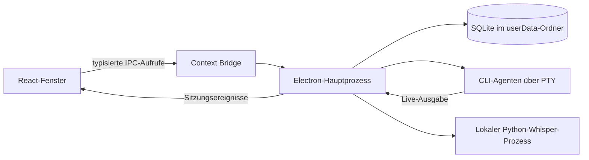

# Architektur der ersten Desktop-Stufe

Branchloom ist eine eigenständige Electron-App. Der React-Renderer zeigt Board, Workflow-Planung, CLI-Sitzungen und Memory. Er erhält ausschließlich die in `src/shared/types.ts` beschriebene `window.studio`-Schnittstelle aus dem isolierten Preload. Datei-, Prozess- und Datenbankzugriff bleiben im Electron-Hauptprozess.

## Datenfluss

SQLite hält Projekte, Spalten, Karten, Agentenprofile, Sitzungen, Workflows und manuelle Memory-Notizen. Die Datenbank liegt im Betriebssystem-Datenordner, nicht im Git-Projekt. Beim Neustart werden abgebrochene Sitzungen und Workflows zur Prüfung markiert. Die App spielt einen möglicherweise bereits ausgeführten externen Schreibschritt nicht blind erneut ab.

CLI-Agenten werden mit ausführbarem Pfad und Argumentliste gestartet, nicht über eine zusammengesetzte Shell-Zeile. Live-Ausgabe und Stop laufen über PTY. Ein Workflow-Schritt braucht einen erfolgreichen Prozessabschluss und einen Abschlussmarker aus der finalen Antwort; ein Fehler oder fehlender Marker hält den Ablauf an. Der globale Workflow-Agent ist davon getrennt: Er erstellt zunächst einen Vorschlag aus einer natürlichen Anfrage. Erst die ausdrückliche Übernahme legt Karten und Workflow-Daten an.

Die erste Spracheingabe nimmt einen kurzen Clip im Renderer auf und reicht die Bytes an einen lokalen Python-Prozess. Das Modell lädt während einer Transkription keine Daten aus dem Netz; Audio wird in diesem Pfad nicht als Datei abgelegt. Die einmalige Modellinstallation ist ein eigener Setup-Schritt.

## Grenzen, die vor weiterer Automatisierung geschlossen werden müssen

- Ein CLI-Agent läuft derzeit mit den Dateirechten des angemeldeten Windows-Benutzers. Projektordner und andere erreichbare Dateien sind dadurch keine harte Sicherheitsgrenze. Isolierte Git-Worktrees, Berechtigungsprofile und optional getrennte OS-Identitäten sind vor breiter unbeaufsichtigter Ausführung nötig.
- Die App hat noch keine zuverlässige Gesprächswiederaufnahme für jeden CLI-Adapter nach WLAN-Ausfall. Neustart markiert laufende Arbeit zur Prüfung.
- Der manuelle Memory-Graph ist noch keine automatische, quellenbelegte Indizierung von Gesprächen, Dateien und Commits.
- Der globale Workflow-Planer ist eine erste sichere Stufe. Ein dauerhaftes Planer-Gespräch mit Vorschlagskorrekturen und mehr Agent-Adaptern folgt.
- Ein öffentlicher Repository-Scan findet typische Schlüssel und lokale Datenpfade. Er ersetzt keine OS-Isolation und keine Prüfung des konkreten Diffs vor einem Push.

Die detaillierte Funktions- und Abnahmeliste steht in [PARITY.md](PARITY.md), der überprüfte Stand in [STATUS.md](STATUS.md).
